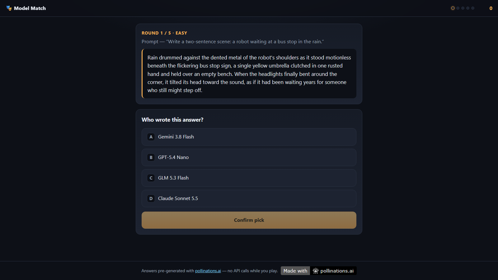

# Model Match

[](https://pollinations.ai/?ref=badge)

**One answer. Four AI models. Who wrote it?** — a five-round guessing game.

▶ **Play:** https://patbing.github.io/model-match/



## How it works

- 5 rounds. Each round shows one anonymous answer to a shared prompt.
- Pick the model you think wrote it. Correct = 100 points; streaks add +10 / +20 / +30 / +40 (max 600).
- Every reveal shows all four answers plus each model's style notes.
- **Daily challenge**: the same five rounds for everyone, seeded by the UTC date + bank version. Practice mode picks random rounds.
- Runs entirely in the browser. **No API calls while you play and no keys in this repository** — answers were pre-generated once, at build time, with the [Pollinations API](https://pollinations.ai).

## The answers bank

- Generated with `gen.pollinations.ai/v1/chat/completions` (see `tools/generate-bank.py`).
- Models: GPT-5.4 Nano, Claude Sonnet 5.5, Gemini 3.8 Flash, GLM 5.3 Flash.
- 24 prompts across 6 categories × 4 models = 96 generations, shared system prompt, `max_tokens: 1500`, provider-default temperature.
- Token totals per model: `bank_manifest.json` (no keys — API keys are never written to any output file).
- Difficulty labels (easy / medium / hard) come from an automatic similarity pass over each prompt's four answers.

## Development

```bash
npm run check                  # validate the bank + run unit tests (zero dependencies)
python3 -m http.server 8080    # serve locally, then open http://localhost:8080
```

Layout: `index.html`, `src/` (ES modules), `data/bank.v1.json`, `scripts/validate-bank.mjs`, `tests/unit/`.

## Notes & limitations

- Static, client-side scoring: a determined reader could inspect the bank to find answers. This is a casual game — there is no leaderboard and no anti-cheat guarantee.
- Style notes describe tendencies in these answer samples, not fixed traits of each model.
- Difficulty labels (easy / medium / hard) come from an automatic relative-similarity pass over each prompt's four answers — a heuristic that may not match how hard a round feels to you.

## License

MIT
